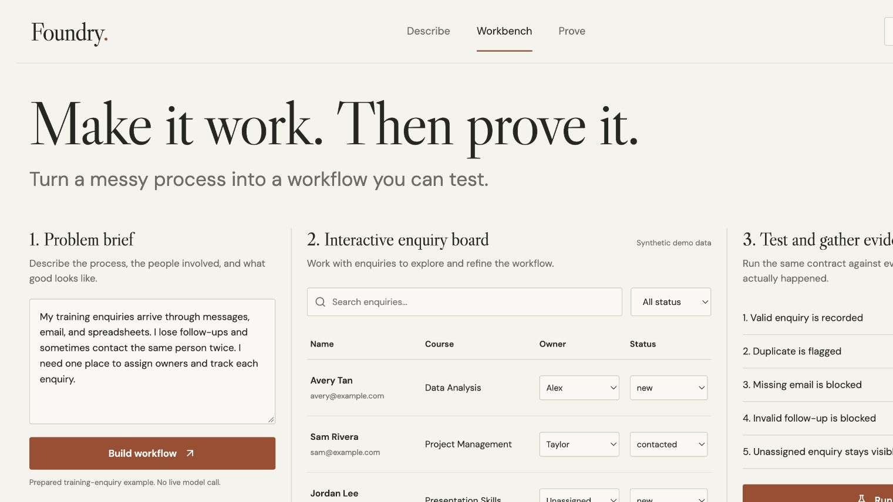
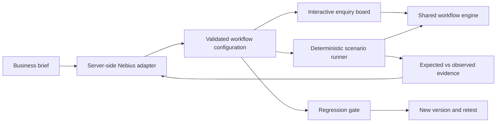

# Foundry

**Make it work. Then prove it.**

Foundry turns a messy training-enquiry process into a working workflow and tests every proposed improvement against an unchanged executable contract. It combines a usable enquiry board, a structured model adapter, a deterministic scenario runner, and a regression gate.



[Try the public sample](https://dcontessa.github.io/foundry-workflow/) · [Verification notes](docs/QA.md)

The public preview runs prepared sample configurations. Live NVIDIA inference remains pending. All 14 automated checks pass, including local fixture-backed HTTP integration checks.

## Run locally

Requires Node.js 22.18+ (tested on Node 26) and npm.

```sh
npm ci
npm test
npm run build
npm run server
```

Open http://127.0.0.1:8787. Sample mode works without credentials. It is explicitly labelled and uses a prepared, intentionally incomplete baseline; it is not live model generation.

For development, run `npm run server` and `npm run dev` in separate terminals. Vite proxies `/api` to the backend.

## Judge walkthrough

1. Leave **Sample mode** selected and click **Build workflow**.
2. Click **Run tests**. The prepared baseline passes 2/5 tests.
3. Expand a failed test to inspect expected and observed outcomes.
4. Click **Propose repair**. Review the changed rules in the left rail.
5. Click **Apply repair & rerun**. The same contract now passes 5/5, and the unassigned enquiry becomes visible.
6. Use **Add enquiry**. A missing email, duplicate email/course, or follow-up before the received date is blocked by the improved workflow.
7. Download the JSON evidence. Reset returns only this browser's synthetic demo to its starting state.

The five scenarios run on isolated fixtures through the same `createEnquiry` and `visibleEnquiries` functions that power the board. Passing scenarios must stay passing before a repair is accepted. These results demonstrate this contract only, not general business reliability.

## Nebius + NVIDIA integration

The backend supports Nebius Token Factory's OpenAI-compatible chat-completions API. Model configuration is server-side. Choose an available NVIDIA Nemotron model from your Nebius catalog to meet the hackathon requirements; the exact available model and successful inference must be verified before claiming sponsor integration.

Set `NEBIUS_API_KEY`, `NEBIUS_MODEL`, and optionally `NEBIUS_BASE_URL` in an ignored `.env` file or deployment secrets. Do not place a key in any `VITE_` variable or browser code. Restart the server after configuring it; **Nebius live** becomes selectable when a server key is present. The health indicator confirms configuration, not successful inference. Failed requests never silently fall back to sample mode.

The server requests a strict, bounded configuration, validates the returned JSON with Zod, and never executes model-generated code. It returns real model identifiers, latency, and token usage when supplied by the provider. Hosted demo calls are limited to 20 requests/hour per direct client address; a production deployment needs stronger authentication and distributed limits.

**Current verification status:** sample mode and browser workflow verified; live NVIDIA inference pending account/key access. The NVIDIA model available in the checked Nebius catalog is `nvidia/NVIDIA-Nemotron-3-Nano-30B-A3B`; this is the server default. Catalog availability is not proof of successful inference.

## Architecture



React + TypeScript + Vite; Node HTTP server; Zod; Lucide icons. Business data and run history are stored in the local browser. The server receives the brief, configuration, and synthetic test failures, not the board's customer records.

## Scope and limitations

- One constrained training-enquiry workflow, not arbitrary application generation.
- Synthetic demo data only. No email, WhatsApp, payment, or CRM connection.
- No customer traction, time-saving, ROI, or production-security claims.
- Local storage is not a secure multi-user database. No account system or synchronization.
- A repaired test suite proves the specified scenarios; it does not prove all possible cases.
- The user reviews a repair before it is applied.

## Deployment

`render.yaml` describes a Node web service. Set the Nebius API key and NVIDIA model in hosting secrets; build with `npm ci && npm run build`; start with `npm run start`. No cloud resource has been deployed by this configuration alone.

Official event: https://nebiusglobalaihackathon.devpost.com/

## License

MIT — see [LICENSE](LICENSE).
